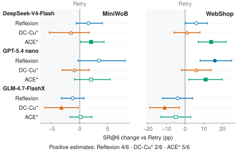
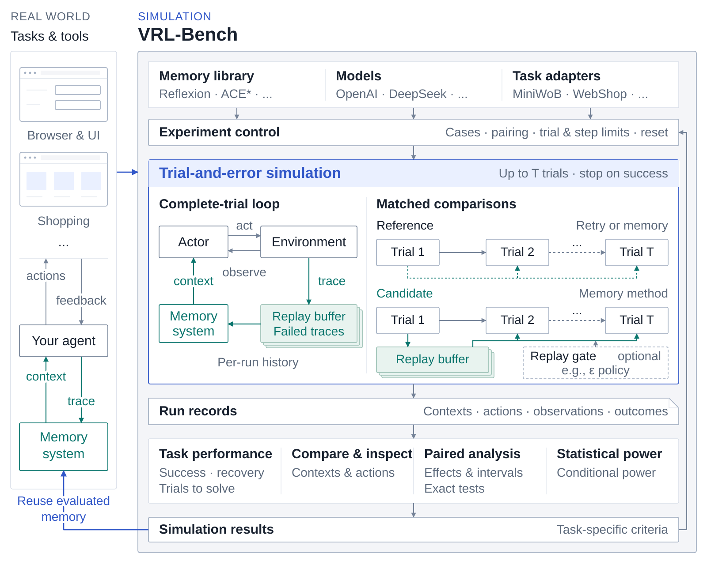
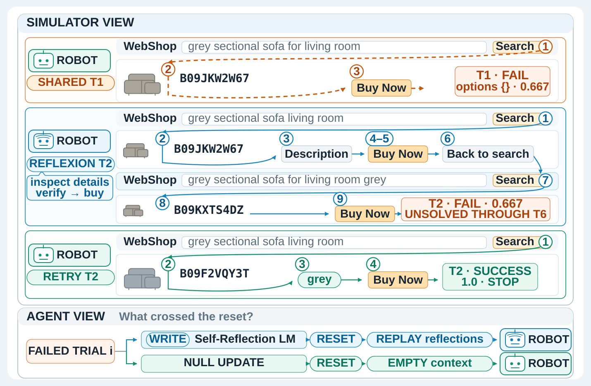

<h1 align="center">
  <picture>
    <source media="(prefers-color-scheme: dark)" srcset="docs/assets/brand/logo-dark.png">
    <source media="(prefers-color-scheme: light)" srcset="docs/assets/brand/logo-light.png">
    
  </picture>
</h1>

<h3 align="center">A Unified Simulator for Agent Memory Systems</h3>

<p align="center">English · <a href="README.zh-CN.md">简体中文</a></p>

<p align="center">
  <a href="#about">About</a> ·
  <a href="#quick-start">Get Started</a> ·
  <a href="#memory-library">Memory Library</a> ·
  <a href="#documentation">Documentation</a> ·
  <a href="https://arxiv.org/abs/2609.12404">Paper</a> ·
  <a href="#contributing">Contribute</a>
</p>

## About

VRL-Bench is an open systems framework for **building, simulating, and comparing agent memory** from NASP, Tsinghua University.

**Fair memory evaluation is a fundamental, long-overlooked problem in
language-agent research.** Methods are evaluated on different tasks, with
different actors, budgets, and metrics, making their reported gains difficult
to compare.

We advocate **trial and error as a scientific basis for evaluating agent
memory**. In **verbal reinforcement learning (VRL)**, a language-model agent
turns interaction feedback into verbal experience and uses it in later
attempts. Repeated attempts at the same task let us test whether retaining,
retrieving, and applying experience improves subsequent actions, failure
recovery, and task success.

VRL-Bench makes this approach **repeatable through controlled trial-and-error
simulation**. It runs resettable task environments with matched actors, task
cases, trial budgets, and per-trial interaction limits, recording memory,
actions, feedback, and outcomes. Researchers and engineers can build simulations
around their own agents and tasks, compare and refine memory systems under the
same conditions, then use the evaluated implementation in that agent's real tasks.

<a id="memory-can-hurt"></a>

**Memory can hurt the agents it is meant to improve.** In our
[evaluation](https://arxiv.org/abs/2609.12404) across three models on MiniWoB and
WebShop, leading memory methods do not consistently outperform even
memory-free Retry under matched trial-and-error budgets. They improve task
success in some settings and reduce it in others.

<p align="center">
  
</p>

*Success-rate changes versus memory-free Retry within six trials, in percentage
points, with paired 95% confidence intervals. Filled markers have intervals
excluding zero; \* marks failure-only trial-and-error adaptations.
[Study and interpretation](docs/RESEARCH.md#memory-can-helpor-hurt).*

**Fair evaluation revealed an unexpected exploration–exploitation tension in
verbal RL.** Retained experience can guide later attempts, but relying on it
can also displace useful exploration. Our
[controlled reflection-exposure experiments](docs/RESEARCH.md#experience-exposure-creates-an-explorationexploitation-decision)
show that replaying more reflection can reduce task success—an effect that is
hard to observe in one-off use or cross-task experience reuse.

<a id="the-simulator"></a>

- **[Simulate real tasks](docs/SIMULATION.md).** Run repeated attempts at the
  same task, resetting after failure and stopping on success or the trial
  limit. Observe how experience changes later attempts.
- **Compare memory methods fairly.** Match actors, task cases, trial budgets,
  and interaction limits. Compare memory systems with one another and with
  [memory-free Retry](docs/RESEARCH.md#memory-can-helpor-hurt).
- **Develop memory systems.** Implement retention, retrieval, context
  construction, or scheduling. Use [`evaluate_candidate()`](docs/DEVELOPMENT.md)
  to improve complete implementations from task metrics and case-level feedback.
- **Control experience exposure.** Use a
  [Replay gate](docs/SIMULATION.md#replay-gate) to control experience replay and study
  the tension between exploiting past experience and continued exploration.
- **Inspect behavior and performance.** [Step through recorded actions](docs/QUICKSTART.md#inspect-and-compare)
  alongside page observations and memory; track task success, recovery after
  an initial failure, trials to solve, and model calls.
- **Evaluate results statistically.** Compare methods with
  [paired confidence intervals, exact tests, and conditional power](docs/STATISTICS.md)
  to assess outcome differences and uncertainty.

<p align="center">
  <picture>
    <source media="(prefers-color-scheme: dark)" srcset="docs/assets/simulator-overview-dark.svg">
    <source media="(prefers-color-scheme: light)" srcset="docs/assets/simulator-overview.svg">
    
  </picture>
</p>

<p align="center">
  <strong>0.1</strong> · MiniWoB + WebShop · Reusable memory library ·
  Extensible methods, models, and workloads
</p>

## Quick start

Select a workload, configure the model and memory method, then use the same
`simulate` → `inspect` → `compare` workflow. MiniWoB and WebShop are the first
integrated environments; add your own tasks through a workload adapter.

| Environment | Task family | Setup and configuration |
|---|---|---|
| MiniWoB | Browser and UI interaction | [Python 3.12 + Chromium](docs/QUICKSTART.md#use-miniwob) · [Example config](examples/configs/miniwob_retry.json) |
| WebShop | Interactive shopping | [Python 3.10 + Java 11](docs/QUICKSTART.md#webshop-setup) · [Example config](examples/configs/webshop_retry.json) |
| Your tasks | Your agent and environment | [Connect a workload adapter](docs/DEVELOPMENT.md#add-a-task-environment) |

Clone the repository:

```bash
git clone https://github.com/vrl-bench/vrlbench.git
cd vrlbench
```

Follow the selected environment's setup guide above, activate its Python
environment, and install the SDK:

```bash
python -m pip install -e '.[runtime]'
```

The example below uses **WebShop** to demonstrate the shared workflow. Set the
same model in the three configurations and supply your API key through an
environment variable. They select two goals, with up to six trials per goal.
Runs execute the configured models and may incur API charges.

Run memory-free Retry first, then compare recent failure traces and Reflexion:

```bash
vrlbench simulate --config examples/configs/webshop_retry.json
vrlbench simulate --config examples/configs/webshop_trace_memory.json
vrlbench simulate --config examples/configs/webshop_reflexion.json
vrlbench inspect runs/webshop_reflexion --case sample_0000
vrlbench compare runs/webshop_retry runs/webshop_trace_memory runs/webshop_reflexion
```

The memory conditions reuse Retry's completed first trial under matched cases
and budgets. Inspect the recorded contexts and actions to see how each method
uses failure feedback, then compare success, recovery, and trials to solve.
Add [paired statistics](docs/STATISTICS.md) to assess differences and uncertainty.

For a browser replay, use `vrlbench replay runs/webshop_reflexion`. It reads
saved actions, observations, and memory without new model calls.
[Enable page capture](docs/QUICKSTART.md#inspect-and-compare) before a run to
include native page snapshots.

<details>
<summary>Example: inspect a recorded six-trial comparison</summary>

WebShop case `sample_0009` from the paper's **T=6** experiment with
`gpt-5.4-nano`, also shown in the [case visualization](docs/assets/trial-and-error.svg).
This excerpt shows the shared first trial and each method's second trial;
the reflection is shortened with ellipses.

```text
Case: sample_0009  Task: webshop  Trial budget: 6

=== Shared Trial 1 / 6: FAIL ===
user_context:
[no cross-trial memory]
actions:
> search[grey sectional sofa for living room]
> click[b09jkw2w67]
> click[buy now]

=== Reflexion Trial 2 / 6: FAIL ===
user_context:
...
click a promising grey sectional listing (e.g., click[B09JKW2W67]) … scan Description/Features
...
actions:
> search[grey sectional sofa living room]
> click[b09jkw2w67]
> click[description]
> click[buy now]
> click[buy now]
> click[back to search]
> search[grey sectional sofa for living room grey]
> click[b09kxts4dz]
> click[buy now]

=== Retry Trial 2 / 6: SUCCESS ===
user_context:
[no cross-trial memory]
actions:
> search[grey sectional sofa living room]
> click[b09f2vqy3t]
> click[grey]
> click[buy now]
```

Reflexion remained unsolved through trial six; Retry stopped after succeeding
on trial two. Inspect memory, actions, and outcomes together when comparing
or revising a memory system.

</details>

Continue with the [complete walkthrough](docs/QUICKSTART.md), or use
[`evaluate_candidate()`](docs/DEVELOPMENT.md#evaluate-a-complete-implementation)
to evaluate and improve your own memory system on the same tasks.
For an installation and API check without benchmark downloads, use the
[local interface example](docs/QUICKSTART.md#local-interface-check).

## Memory library

VRL-Bench integrates memory strategies from leading conferences, spanning
[Reflexion (2023)](https://proceedings.neurips.cc/paper_files/paper/2023/hash/1b44b878bb782e6954cd888628510e90-Abstract-Conference.html)
to [ACE* (2026)](https://arxiv.org/abs/2510.04618).

The library provides [method implementations, prompts, and original sources](docs/DEVELOPMENT.md#reference-implementations)
for use as research baselines or as memory components in your own agents.

Stars mark failure-only trial-and-error adaptations. Benchmark-specific prompt
adapters are described in the [method reference](docs/DEVELOPMENT.md#reference-implementations).

Load a method and connect it to your agent loop:

```python
from vrlbench import list_methods, load_method

print(list_methods())  # retry, reflexion, dc_cu, ace, vex2
memory = load_method("reflexion")
```

Follow the [integration guide](docs/DEVELOPMENT.md#connect-your-agent-loop) to
connect your model client, pass trial feedback, and retrieve memory context
for the next attempt.

## Research

<a id="why-trial-and-error"></a>
<a id="reference-results"></a>
<a id="explorationexploitation-in-verbal-reinforcement-learning"></a>

**When should an agent rely on experience, and when should it keep exploring?**
The recorded WebShop case below illustrates this question through the memory
supplied to the actor and the actions it takes.

<p align="center">
  
</p>

*One recorded WebShop case: after the same failed first trial, Reflexion remains
unsolved through trial six, while memory-free Retry explores another product
and succeeds on trial two.*

To study this trade-off, our
[reflection-exposure sweeps](docs/RESEARCH.md#experience-exposure-creates-an-explorationexploitation-decision)
compare full replay, partial replay, and memory-free exploration. On AlfWorld,
partial replay outperforms both full replay and memory-free exploration. The
[Replay gate](docs/SIMULATION.md#replay-gate) lets you study how experience
exposure changes your own memory system's decisions and task outcomes.

**VEX² uses an LM to schedule exploration and exploitation.** It jointly
selects policy directions and allocates the remaining trial budget. VEX²
achieves positive observed success-rate gains over memory-free Retry in all
[six evaluated settings](https://arxiv.org/abs/2609.12404), providing empirical
support for this approach. See the
[method reference](docs/DEVELOPMENT.md#reference-implementations) for its
implementation.

Use the [walkthrough](docs/QUICKSTART.md) to design your own comparison, or
read the [paper](https://arxiv.org/abs/2609.12404) for the full study.

## Documentation

- [Get started](docs/QUICKSTART.md) — Install, run a simulation, inspect behavior,
  and complete a memory-system comparison.
- [Develop a memory system](docs/DEVELOPMENT.md) — Implement a method, evaluate it,
  and improve it from task feedback.
- [Analyze results](docs/STATISTICS.md) — Compare task outcomes with paired intervals,
  exact tests, and conditional power.

## Contributing

Contribute memory methods, model integrations, interactive workloads, or
analysis tools. Include a runnable example, tests, attribution for the original
methods, and a description of any task adaptations.

For research using VRL-Bench, cite the framework and the original methods you
use; share your paper and implementation through Issues so others can build
on the work.

[Contribute a method](CONTRIBUTING.md) ·
[Extension interfaces](docs/DEVELOPMENT.md) ·
[Discuss an integration](https://github.com/vrl-bench/vrlbench/issues)

## Citation

```bibtex
@misc{bai2026vrlbenchbenchmarkingagentscomputer,
      title={VRL-Bench: Benchmarking agents on computer control tasks under finite trial budgets},
      author={Yu Bai and Yukai Miao and Dawei Wang and Li Chen and Yanyu Ren and Yuqian Shi and Dan Li and Ying Xiong and Chengqiu Tan and Run Zhou and Li Li},
      year={2026},
      eprint={2609.12404},
      archivePrefix={arXiv},
      primaryClass={cs.AI},
      url={https://arxiv.org/abs/2609.12404},
}
```

[Download BibTeX](CITATION.bib) · [arXiv citation export](https://arxiv.org/bibtex/2609.12404)

## License

First-party code is provided under the [MIT License](LICENSE). Third-party
code, prompts, and benchmark assets retain their original terms; see
[THIRD_PARTY_NOTICES](THIRD_PARTY_NOTICES).
