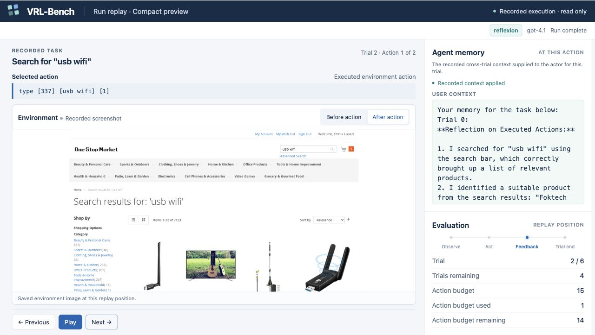
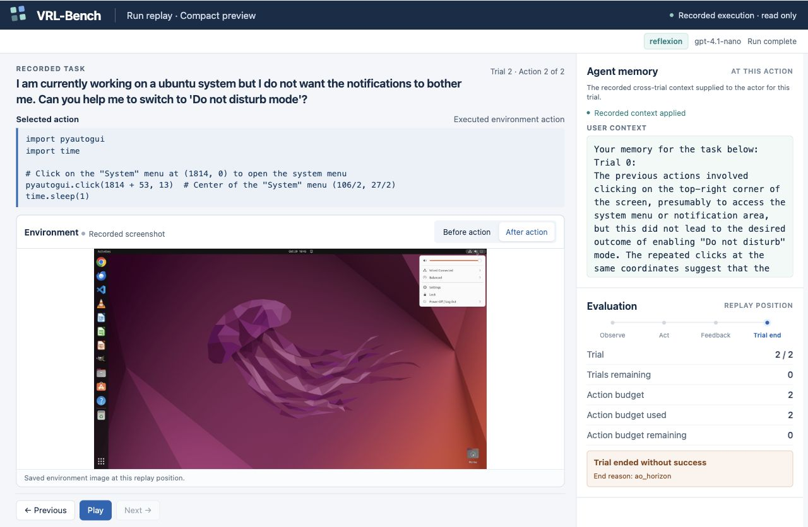

<h1 align="center">
  <picture>
    <source media="(prefers-color-scheme: dark)" srcset="docs/assets/brand/logo-dark.png">
    <source media="(prefers-color-scheme: light)" srcset="docs/assets/brand/logo-light.png">
    
  </picture>
</h1>

<h3 align="center">面向智能体记忆系统的统一仿真器</h3>

<p align="center"><a href="README.md">English</a> · 简体中文</p>

<p align="center">
  <a href="#项目简介">项目简介</a> ·
  <a href="#最新动态">最新动态</a> ·
  <a href="#快速开始">快速开始</a> ·
  <a href="#记忆方法库">记忆方法库</a> ·
  <a href="#文档">文档</a> ·
  <a href="https://arxiv.org/abs/2609.12404">论文</a> ·
  <a href="#参与贡献">参与贡献</a>
</p>

## 项目简介

VRL-Bench 是清华大学 NASP 团队的开源系统框架，用于**开发、仿真和比较智能体记忆系统**。

**如何公平评估记忆，是语言智能体研究中一个重要却长期被忽视的问题。** 不同工作使用的任务、执行智能体、预算和指标各不相同，已有方法的效果往往难以直接比较。

我们主张以**多轮试错（trial and error）作为科学评估智能体记忆的实验范式**。在**语言强化学习（verbal reinforcement learning，VRL）**中，语言模型驱动的智能体将交互反馈转化为语言化经验，用于指导后续尝试。围绕同一任务连续尝试，可以检验经验的保留、提取与利用是否真正改善了后续行动、失败恢复与任务表现。

VRL-Bench 将这一范式实现为**可控、可重复的多轮试错仿真**。在可重置的任务环境中，保持执行智能体、任务、总尝试次数和单轮交互预算一致，记录每轮的记忆、动作、反馈和结果。研究者和工程师可以围绕自己的智能体与任务构建仿真，在其中比较、改进记忆系统，再将经过评估的同一实现用于该智能体的真实任务。

<a id="memory-can-hurt"></a>

**记忆可能反而损害智能体的表现。** 我们在 MiniWoB 和 WebShop 的三种模型[评估](https://arxiv.org/abs/2609.12404)中发现：在公平的多轮试错预算下，多个领先记忆方法仍不能稳定超过朴素的无记忆 Retry。有些设置中成功率提升，有些则反而下降。

<p align="center">
  
</p>

*六轮尝试内，相对无记忆 Retry 的成功率变化，单位为百分点；误差线为配对 95% 置信区间，实心标记表示区间不包含零，星号表示仅使用失败信息的多轮试错适配。[实验与解读](docs/RESEARCH.md#memory-can-helpor-hurt)。*

**公平评估带来了一个意外发现：语言强化学习同样存在探索—利用张力。** 已有经验可以指导后续尝试，依赖经验也可能压缩有价值的探索。[反思暴露控制实验](docs/RESEARCH.md#experience-exposure-creates-an-explorationexploitation-decision)表明，更多地重放反思，反而可能降低任务成功率；这种影响在单次使用或跨任务复用中不易看清。

<a id="仿真器"></a>

- **[仿真真实任务](docs/SIMULATION.md)。** 围绕同一任务反复尝试，失败后重置，成功或用尽尝试次数后停止，观察经验怎样改变后续尝试。
- **公平比较记忆方法。** 保持执行智能体、任务、总尝试次数与单轮交互预算一致，既可比较不同记忆系统，也可与[无记忆 Retry](docs/RESEARCH.md#memory-can-helpor-hurt) 对照。
- **开发记忆系统。** 实现经验保留、检索、上下文构建或调度，通过 [`evaluate_candidate()`](docs/DEVELOPMENT.md) 评估完整实现，根据任务指标和逐案例反馈持续改进。
- **控制经验暴露。** 通过 [Replay gate](docs/SIMULATION.md#replay-gate) 控制经验重放，研究利用已有经验与继续探索之间的张力。
- **观察行为与表现。** [逐步回放实际动作](docs/QUICKSTART.md#inspect-and-compare)，对照页面观测和记忆，统计成功率、首轮失败后的恢复率、解决任务所需的尝试数与模型调用量。
- **进行统计分析。** 使用[配对置信区间、精确检验与条件功效分析](docs/STATISTICS.md)比较不同方法，评估效果差异及其不确定性。

<p align="center">
  <picture>
    <source media="(prefers-color-scheme: dark)" srcset="docs/assets/simulator-overview-dark.svg">
    <source media="(prefers-color-scheme: light)" srcset="docs/assets/simulator-overview.svg">
    
  </picture>
</p>

<p align="center">
  <strong>0.1</strong> · 在线计算机操作任务 · 可复用的记忆方法库 ·
  可扩展的方法、模型与任务
</p>

## 最新动态

- 接入 [WebArena](docs/QUICKSTART.md#use-webarena) 和 [OSWorld](docs/QUICKSTART.md#use-osworld)，将统一评测流程扩展到在线网页与桌面任务。
- 新增[仿真回放 Web UI](#replay)，逐步查看真实页面、实际动作、记忆与预算消耗。
- 引入 [VEX²](docs/DEVELOPMENT.md#reference-implementations)，用语言模型调度探索与利用，六个评估设置的实测成功率均高于无记忆 Retry。
- 通过[经验暴露控制实验](docs/RESEARCH.md#experience-exposure-creates-an-explorationexploitation-decision)，揭示语言强化学习中的探索—利用张力：更多重放并不总能带来更好表现。
- 在[公平的多轮试错比较](docs/RESEARCH.md#memory-can-helpor-hurt)中发现，多个领先记忆方法仍不能稳定胜过无记忆 Retry。
- 重评 [Reflexion 的多轮试错表现](docs/RESEARCH.md#memory-can-helpor-hurt)，发现反思也可能降低任务成功率。
- …

## 快速开始

选择任务环境，配置模型与记忆方法，并明确填写总尝试次数 `trials` 和每轮行动上限 `max_environment_steps`，再用 `simulate` → `inspect` → `compare` 完成在线计算机操作任务的评测。

| 环境 | 任务类型 | 安装与配置 |
|---|---|---|
| MiniWoB | 浏览器与界面操作 | [Python 3.12 + Chromium](docs/QUICKSTART.md#use-miniwob) · [示例配置](examples/configs/miniwob_retry.json) |
| WebShop | 交互式购物 | [Python 3.10 + Java 11](docs/QUICKSTART.md#webshop-setup) · [示例配置](examples/configs/webshop_retry.json) |
| WebArena | 自部署网站上的操作任务 | [网站与浏览器环境](docs/QUICKSTART.md#use-webarena) · [示例配置](examples/configs/webarena_retry.json) |
| OSWorld | 可重置虚拟机中的桌面任务 | [虚拟机与视觉模型](docs/QUICKSTART.md#use-osworld) · [示例配置](examples/configs/osworld_retry.json) |
| 自己的任务 | 自有智能体与环境 | [接入任务适配器](docs/DEVELOPMENT.md#add-a-task-environment) |

克隆仓库：

```bash
git clone https://github.com/vrl-bench/vrlbench.git
cd vrlbench
```

按上表中的安装指南准备所选环境，激活对应的 Python 环境，再安装 SDK：

```bash
python -m pip install -e '.[runtime]'
```

下面以 **WebShop** 展示共同流程。在三份示例配置中设置相同的模型，并通过环境变量提供 API key。配置选择两个购物目标，每个目标最多尝试六轮。运行会实际调用模型，可能产生 API 费用。

先完成无记忆 Retry，再运行保留近期失败轨迹的方法与 Reflexion：

```bash
vrlbench simulate --config examples/configs/webshop_retry.json
vrlbench simulate --config examples/configs/webshop_trace_memory.json
vrlbench simulate --config examples/configs/webshop_reflexion.json
vrlbench inspect runs/webshop_reflexion --case sample_0000
vrlbench compare runs/webshop_retry runs/webshop_trace_memory runs/webshop_reflexion
```

记忆方法复用 Retry 已完成的首轮尝试，并保持任务与预算一致。检查各轮上下文和动作，观察不同方法怎样利用失败反馈，再比较成功率、失败恢复和解决任务所需的尝试数。通过[配对统计分析](docs/STATISTICS.md)进一步判断差异及其不确定性。

<a id="replay"></a>

**回放浏览器与桌面操作。** 逐步查看智能体当时看到的页面、执行的动作、实际收到的记忆、环境反馈，以及剩余尝试次数和行动预算。

```bash
vrlbench replay runs/webshop_reflexion
```

回放只读取已保存的记录，不会新增模型调用。如需查看原生页面快照，在运行前[启用页面录制](docs/QUICKSTART.md#inspect-and-compare)。

<p align="center">
  <a href="docs/assets/replay/webarena.jpg"></a>
</p>

*WebArena 第二轮的紧凑视图：对照真实页面、实际动作、记忆片段和剩余预算。点击预览可查看完整回放截图。*

<details>
<summary>OSWorld：查看桌面操作与每轮结果</summary>

<p align="center">
  <a href="docs/assets/replay/osworld.jpg"></a>
</p>

*桌面短测的紧凑视图：共两轮尝试，每轮两次行动。图中动作打开了系统菜单，本轮未成功。点击预览可查看完整回放截图。*

</details>

<details>
<summary>案例：对照六轮实验中的记忆、动作和结果</summary>

以下是论文中使用 `gpt-5.4-nano`、预算为 **T=6** 的 WebShop 案例 `sample_0009`，与[案例图示](docs/assets/trial-and-error.svg)使用同一条记录。这里只展示共享的首轮尝试和两种方法各自的第二轮；反思按原文摘录，省略处用省略号标出。

```text
Case: sample_0009  Task: webshop  Trial budget: 6

=== Shared Trial 1 / 6: FAIL ===
user_context:
[no cross-trial memory]
actions:
> search[grey sectional sofa for living room]
> click[b09jkw2w67]
> click[buy now]

=== Reflexion Trial 2 / 6: FAIL ===
user_context:
...
click a promising grey sectional listing (e.g., click[B09JKW2W67]) … scan Description/Features
...
actions:
> search[grey sectional sofa living room]
> click[b09jkw2w67]
> click[description]
> click[buy now]
> click[buy now]
> click[back to search]
> search[grey sectional sofa for living room grey]
> click[b09kxts4dz]
> click[buy now]

=== Retry Trial 2 / 6: SUCCESS ===
user_context:
[no cross-trial memory]
actions:
> search[grey sectional sofa living room]
> click[b09f2vqy3t]
> click[grey]
> click[buy now]
```

Reflexion 直到第六轮仍未成功，Retry 则在第二轮成功后停止。比较或改进记忆系统时，可以把实际使用的记忆、后续动作和任务结果放在一起检查。

</details>

按[完整教程](docs/QUICKSTART.md)继续，或用 [`evaluate_candidate()`](docs/DEVELOPMENT.md#evaluate-a-complete-implementation)在同样的任务上评估、改进自己的记忆系统。如需先检查安装与接口，可运行[不依赖基准下载的本地示例](docs/QUICKSTART.md#local-interface-check)。

## 记忆方法库

从 [Reflexion（2023）](https://proceedings.neurips.cc/paper_files/paper/2023/hash/1b44b878bb782e6954cd888628510e90-Abstract-Conference.html)到 [ACE*（2026）](https://arxiv.org/abs/2510.04618)，VRL-Bench 集成了多篇高水平会议论文提出的记忆策略。

方法库提供[各方法的实现、提示词和原始来源](docs/DEVELOPMENT.md#reference-implementations)，可用作研究基线，也可直接接入自己的智能体。

星号表示在仅有失败信息的多轮试错条件下进行的适配。不同任务环境的提示词适配见[方法参考](docs/DEVELOPMENT.md#reference-implementations)。

加载记忆方法，接入智能体循环：

```python
from vrlbench import list_methods, load_method

print(list_methods())  # retry, reflexion, dc_cu, ace, vex2
memory = load_method("reflexion")
```

按[接入指南](docs/DEVELOPMENT.md#connect-your-agent-loop)连接模型客户端，传入各轮反馈，并读取下一轮的记忆上下文。

## 研究

<a id="reference-results"></a>
<a id="explorationexploitation-in-verbal-reinforcement-learning"></a>
<a id="为什么研究多轮试错"></a>

**智能体何时应当依靠已有经验，何时应当继续探索？** 下面的 WebShop 真实记录，通过智能体实际收到的记忆和执行的动作展示了这个问题。

<p align="center">
  
</p>

*一个已记录的 WebShop 案例：在同一次首轮失败后，Reflexion 直到第六轮仍未解决任务，而无记忆 Retry 探索了另一件商品，在第二轮成功。*

为研究这种权衡，我们通过[经验暴露控制实验](docs/RESEARCH.md#experience-exposure-creates-an-explorationexploitation-decision)，比较完整重放、部分重放与无记忆探索，发现 AlfWorld 上的部分重放优于另外两种条件。[Replay gate](docs/SIMULATION.md#replay-gate) 支持开展这类实验，检验经验暴露如何影响记忆系统引导的行动与任务表现。

**VEX² 让语言模型调度探索与利用。** 它同时选择策略方向、分配剩余尝试预算。在[论文的六个评估设置](https://arxiv.org/abs/2609.12404)中，VEX² 相对无记忆 Retry 的成功率变化全部为正，为这一思路提供了实证支持。具体实现见[方法参考](docs/DEVELOPMENT.md#reference-implementations)。

按[完整教程](docs/QUICKSTART.md)设计自己的比较实验，或阅读[论文](https://arxiv.org/abs/2609.12404)了解完整研究。

## 文档

以下详细指南目前为英文。

- [开始使用](docs/QUICKSTART.md)：安装、运行仿真、观察行为，完成一次记忆系统比较。
- [开发记忆系统](docs/DEVELOPMENT.md)：实现、评估并根据任务反馈改进记忆方法。
- [分析结果](docs/STATISTICS.md)：比较任务效果，计算配对区间、精确检验和条件功效。

## 参与贡献

欢迎贡献记忆方法、模型接入、交互任务或分析工具。请附上可运行的示例、测试、原始方法来源和任务适配说明。

使用 VRL-Bench 开展研究时，请引用框架及实际采用的原始方法，也欢迎通过 Issues 分享论文与实现，方便其他人在此基础上继续研究。

[贡献方法](CONTRIBUTING.md) ·
[扩展接口](docs/DEVELOPMENT.md) ·
[讨论接入](https://github.com/vrl-bench/vrlbench/issues)

## 引用

```bibtex
@misc{bai2026vrlbenchbenchmarkingagentscomputer,
      title={VRL-Bench: Benchmarking agents on computer control tasks under finite trial budgets},
      author={Yu Bai and Yukai Miao and Dawei Wang and Li Chen and Yanyu Ren and Yuqian Shi and Dan Li and Ying Xiong and Chengqiu Tan and Run Zhou and Li Li},
      year={2026},
      eprint={2609.12404},
      archivePrefix={arXiv},
      primaryClass={cs.AI},
      url={https://arxiv.org/abs/2609.12404},
}
```

[下载 BibTeX](CITATION.bib) · [arXiv 引用导出](https://arxiv.org/bibtex/2609.12404)

## 许可

本项目自行编写的代码采用 [MIT 许可](LICENSE)。第三方代码、提示词和基准资源仍遵循各自的原有条款，详见 [THIRD_PARTY_NOTICES](THIRD_PARTY_NOTICES)。
