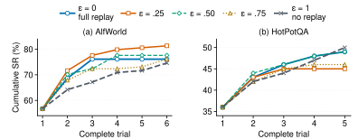

# Research behind VRL-Bench

[README](../README.md) · [Develop a memory system](DEVELOPMENT.md) · [Paper](https://arxiv.org/abs/2609.12404)

VRL-Bench grew from a counterintuitive finding: recording and replaying
experience can reduce an agent's task success. Trial-and-error experiments
make this problem observable across successive attempts at the same task,
and expose an exploration–exploitation trade-off in verbal reinforcement
learning. These findings motivate a simulator for studying memory systems,
not an assumption that any one memory mechanism will always help.

The figures and measurements below are from the
[VRL-Bench paper](https://arxiv.org/abs/2609.12404), which describes the
experimental settings and analyses.

## Memory can help—or hurt

Across three models on MiniWoB and WebShop, established memory updates improve
success in some settings and reduce it in others. The same update can help one
actor and hurt another. This is a systems concern for agents that rely on
self-generated reflection, and a reason to test memory through repeated task
execution rather than assume that retaining experience ensures progress.

  

*Memory updates can reduce task success. SR@6 changes versus Retry are in
percentage points, with paired 95% confidence intervals; filled markers have
intervals excluding zero.*

## Follow what memory changes

  

*The simulator view shows actions and outcomes; the agent view shows what
memory crosses the reset. In this WebShop case, Reflexion remains unsolved
through trial six while Retry succeeds on trial two after the same first failure.*

## Experience exposure creates an exploration–exploitation decision

Replaying reflection exploits past experience; withholding it lets the actor
continue exploring without cross-trial advice. We control that exposure to test
whether using more reflection actually improves task performance.

### Control exposure, not individual actions

The paper's fixed-ε sweep uses GPT-4o mini in Reflexion's HotPotQA and AlfWorld
settings. After the shared memory-free first trial, a gate controls the next
actor's access to its reflections:

- With probability **1 − ε**, replay the stored reflection: exploit experience.
- With probability **ε**, withhold it for that trial: continue exploring
  without cross-trial reflection.

The grid is **ε ∈ {0, .25, .50, .75, 1}**, held fixed within each condition.
This is trial-level exposure control, not randomizing individual tool actions.
The conditions use the same actor and task cases, shared first trials and
matched trial limits, stopping on success. Interior conditions continue writing
reflection after failures and retain it even when the gate withholds it.
Endpoints reuse full-replay and no-memory runs; the no-memory endpoint does not
generate reflection.

  

*More replay is not always better. Cumulative success for five fixed ε settings;
panels (a–b) from the [paper](https://arxiv.org/abs/2609.12404).*

### What the sweep reveals

**Replaying more reflection is not a reliable route to better performance.**
Full replay reaches 76.1% on AlfWorld, while ε = .25 reaches 81.3%, higher than
either endpoint. On HotPotQA, full replay finishes at 49%, compared with 50%
without replay.

These observed patterns reveal an empirical exploration–exploitation trade-off
in verbal reinforcement learning. Reflection can help an agent use what it has
learned, but relying on it can also displace useful exploration. This challenges
an assumption behind Reflexion-style extensions: writing and replaying lessons
does not by itself ensure progress. The risk should be measured in the agent's
actual multi-trial task outcomes. These are observations in the paper's
settings, not a universally optimal epsilon or a guarantee that memory will
help. The paper discusses paired comparisons, uncertainty and their
interpretation.

### From exposure control to VEX²

VEX² makes the exploration–exploitation decision an LM's scheduling task.
Given the failed-trial history and remaining trial budget, one joint response
selects policy directions and allocates the remaining opportunities. The actor
receives that response unchanged. It is one integrated method, not a separate
retrieval stage followed by an externally imposed policy selector.

The [development guide](DEVELOPMENT.md#reference-implementations) links to its
implementation and API.

## Design your own comparison

Start with the task family and the memory decision you want to investigate.
Keep the actor, cases, reset rules, complete-trial budget and interaction limits
matched while changing the memory method or its exposure policy. Inspect the
contexts actually delivered to the actor and the resulting actions alongside
task outcomes and model usage.

Follow the [walkthrough](QUICKSTART.md) to run a matched comparison and the
[statistical guide](STATISTICS.md) to choose an analysis unit and interpret
uncertainty. Retry is a memory-free reference; other memory methods can also
serve as the reference.

For exposure experiments, configure an optional
[replay gate](SIMULATION.md#replay-gate). Epsilon is one policy, not an
automatically optimized setting. The gate preserves normal memory generation
and updates, so `epsilon=1` withholds memory but does not reproduce the paper's
no-generation endpoint. Run Retry separately for that comparison and account
for generation calls and tokens.

When discussing the paper's findings or building on VRL-Bench, cite the
[paper](../README.md#citation) and the original memory methods you use.
