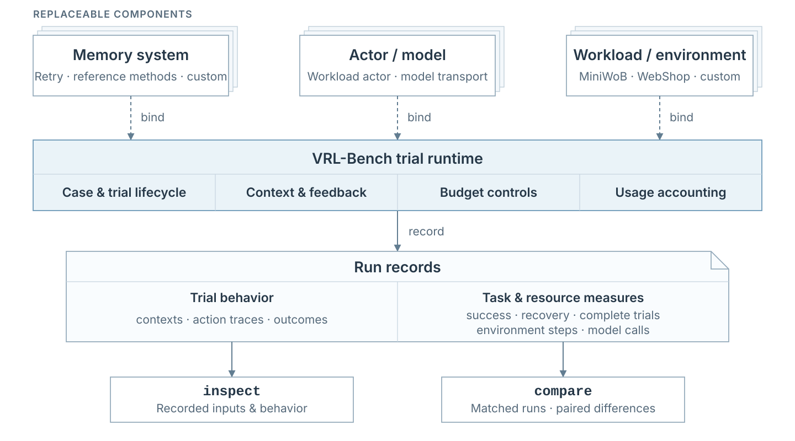

# Simulation reference

[README](../README.md) · [Run a simulation](QUICKSTART.md) · [Develop a memory system](DEVELOPMENT.md)

`SimulationSpec` binds a memory system, actor model, workload, and execution
limits. This page describes the trial loop, saved results, and optional control
over memory exposure. For installation and commands, start with the
[walkthrough](QUICKSTART.md).



## Components and responsibilities

| Component | Owns | Implementation |
|---|---|---|
| Memory system | Extracting, retaining, reading, and scheduling experience | [`MemorySystem`](../src/vrlbench/memory.py) and reference methods |
| Actor and model | Choosing actions from observations and supplied memory | [`ModelSpec`](../src/vrlbench/specs.py), model transport |
| Workload adapter | Task cases, environment interaction, resets, and outcomes | [`WorkloadSpec`](../src/vrlbench/specs.py), [`backends.py`](../src/vrlbench/backends.py) |
| Simulation runtime | Worker isolation, complete trials, budgets, and result collection | [`simulation.py`](../src/vrlbench/simulation.py), [`worker.py`](../src/vrlbench/worker.py) |
| Analysis | Reading behavior and comparing outcomes and resources | [`inspection.py`](../src/vrlbench/inspection.py), [`results.py`](../src/vrlbench/results.py) |

Memory systems can implement these behaviors jointly; the interface does not
require separate extraction, retrieval, or scheduling components. VEX² remains
one integrated scheduler. The simulator supplies its inputs and uses its returned
context without interpreting or repairing its policy decisions.

## Execution

1. **Declare the system.** `SimulationSpec` connects a `MemorySpec`, `ModelSpec`,
   and `WorkloadSpec` with trial and interaction limits. `plan(spec)` checks the
   configuration without importing plugins or making model calls.
2. **Start an isolated worker.** `simulate(spec)` binds the selected components
   in a fresh process. New memory state is created for each case.
3. **Execute a complete trial.** The actor reads the task, observation, and memory
   context, then acts in the environment. The environment determines feedback and
   the outcome; the adapter enforces its action interface and interaction limit.
4. **Update and try again.** After failure with trials remaining, the memory
   system receives the executed trace and prepares later context. The environment
   resets, while memory persists within that case. Stop on success or exhaustion
   of the trial budget; clear memory between cases.
5. **Inspect and compare.** Read the actual contexts, actions, feedback, outcomes,
   and resource records. Change a memory-system choice, run it under the same
   conditions, and compare it with Retry or another system.

The [trial-loop diagram](assets/memory-research.svg) expands steps 3–4.
MiniWoB, WebShop, WebArena, and OSWorld use the common trial loop.
Custom workloads use the same runtime through `runtime.run_episode(...)`.

Every simulation must explicitly set `trials` and `max_environment_steps` to
positive integers. Neither budget has a default; missing or invalid values
are rejected before execution. Both limits are retained in the saved results.

`trials` limits the number of complete attempts at a case;
`max_environment_steps` sets the action budget within each
trial. Each native environment action consumes one unit. In OSWorld, one
pyautogui code block is one native action. A response with no
valid action also consumes one unit: the adapter records the rejected response,
returns parser feedback without changing the environment, and continues while
budget remains. Actual environment steps and rejected responses are counted
separately in trial metadata. Success stops the case immediately; an environment
terminal failure or an exhausted action budget ends the current trial. Model
service failures propagate as execution errors, not task failures.

### Additional workloads

| Workload | Reset and outcome semantics | Setup |
|---|---|---|
| WebArena | Restore website data through a required reset callback, then reset the browser; use the official task evaluator | [WebArena](QUICKSTART.md#use-webarena) |
| OSWorld | Restore the VM snapshot and task configuration; use native `evaluate()` for success | [OSWorld](QUICKSTART.md#use-osworld) |

The two additional online adapters currently execute independent first
trials, rather than importing a shared T1. Keep cases, initial-state restoration,
models, and budgets identical when comparing memory methods.

The overview calls the retained within-case trial history a **replay buffer**.
Failed executed traces accumulate across trials, and the memory method controls
how they inform the next trial. This connects VRL's use of experience with RL's
replay idea; it does not imply minibatch sampling or parameter updates. Each
compared run has its own history, which is cleared for a new case.

Memory reaches the actor through the method's normal context path. An optional
[replay gate](#replay-gate) can withhold it for selected trials without changing
memory generation or updates.

## Outputs

`simulate()` returns a `SimulationResult`. Every run preserves its resolved
request, worker logs, and case-level results in `evaluation.json`.
Use `vrlbench inspect RUN --case ID` for the
saved memory context, action–observation trace, outcome, and usage.

`vrlbench replay RUN --output replay.html` turns saved results into a
self-contained, per-action browser viewer without rerunning models or tasks.
Native page capture is enabled explicitly with
`workload.params.capture_observations: true`; otherwise the viewer uses saved
observation text. Capture does not affect actor inputs, budgets, or scoring.
OSWorld saves the screenshots already supplied to its vision actor.
See the [walkthrough](QUICKSTART.md#inspect-and-compare) for recording and export.

SDK-managed model requests also write `provider_requests.jsonl` as each call
starts and finishes. It contains usage counters and request states, not prompts,
responses, or credentials. Run-level model-usage totals count new provider
requests in this run; a copied shared first trial is not charged again.
Case-level ledgers and environment-step totals retain the full simulated trial
history, including that shared prefix.
Completed trials are checkpointed as they finish. If a later trial fails,
inspection and replay retain that completed prefix; the unfinished case still
does not count as a completed evaluation. Completed-call usage also survives
an interruption, and an interrupted request with unknown usage is not reported
as zero cost.

Internal memory writes are visible when the system records them. The
[local example](QUICKSTART.md#3-inspect-memory-and-task-behavior) records actual reads and retention updates in
`memory_events.jsonl` and links them to trials in its report. Unrecorded internal
state remains unknown; the simulator does not generate agent-thinking explanations.

| Measure | Definition |
|---|---|
| SR@T | Fraction of completed cases solved within T trials |
| RR@T | Fraction of first-trial failures recovered by T; `null` if none failed initially |
| Censored AvgT@T | Mean first-success trial, counting unsolved cases as T+1 |
| Steps, model calls | Recorded interaction and inference use |

WebArena and OSWorld also retain the native evaluator's `environment_score`
in trial metadata. A score of 1 counts as complete task success; partial native
scores remain available for inspection rather than being discarded.

Instance-average and task-average SR remain separate. Failed or timed-out runs
are incomplete, not zero scores; unreported usage stays unknown. Call
`result.require_complete()` before using a run in a completed comparison.
`compare` reports descriptive paired differences. Add `--statistics` with an
explicit `--analysis-unit case` or `task` for paired intervals, exact tests and
conditional power. Any memory method can be the reference. See
[statistical comparison](STATISTICS.md).

## Replay gate

A replay gate controls experience exposure to study the tension between
exploiting past experience and continued exploration. The
[exposure experiments](RESEARCH.md#experience-exposure-creates-an-explorationexploitation-decision)
show why this decision matters for task success.

The gate controls whether the actor receives prepared cross-trial memory.
It is off by default and runs after memory and policy preparation, immediately
before the actor reads its system and user memory channels. It does not change
the task prompt, select policy branches, clear history, or stop memory writes.
Memory slots, integrated methods such as VEX², and custom workloads using
`runtime.run_episode` use the same gate.

### Epsilon policy

Add a top-level field to a copy of a simulation configuration:

```json
"replay_gate": {"policy": "epsilon", "epsilon": 0.5, "seed": 42}
```

Or configure it in Python:

```python
from dataclasses import replace
from vrlbench import ReplayGateSpec, SimulationSpec, simulate

spec = SimulationSpec.from_path("examples/configs/local_feedback.json")
spec = replace(
    spec,
    output_dir="runs/feedback-epsilon-05",
    replay_gate=ReplayGateSpec(epsilon=0.5, seed=42),
)
result = simulate(spec).require_complete()
```

This local example makes no model calls. MiniWoB and WebShop require the
[online setup](QUICKSTART.md#5-prepare-an-online-environment), configured model,
and matched first-trial source.

After the memory-free first trial, prepared memory is exposed with probability
`1 - epsilon` and withheld from both channels with probability `epsilon`.
Memory preparation, failure updates, and history retention continue in either
case; the gate does not skip generation calls.

`epsilon=0` delivers normal context unchanged. `epsilon=1` gives the actor no
cross-trial memory but still generates and updates it. Use Retry when the
comparison also requires no memory generation. The
[paper's exposure experiment](RESEARCH.md#experience-exposure-creates-an-explorationexploitation-decision)
uses a separate no-memory endpoint.

Draws depend on the seed, stable case identity, and zero-based trial index,
not the method, epsilon value, case order, or output path. Subsets and epsilon
conditions can therefore share draws. These draws do not replace model
sampling or environment seeds.

### Custom policy

A policy factory returns a callable accepting `ReplayContext` and returning
a strict `bool`: `True` exposes memory. For example, save as `my_gate.py`:

```python
def create_policy():
    def expose(context):
        return context.trial_index % 2 == 0
    return expose
```

Select it with:

```python
from pathlib import Path
from vrlbench import FactorySpec, ReplayGateSpec

gate = ReplayGateSpec(
    policy="custom",
    factory=FactorySpec(f"{Path('my_gate.py').resolve()}:create_policy"),
)
```

`ReplayContext` contains `case_id`, `trial_index`, `total_trials`, `seed`, and
the prepared `system_context` and `user_context`. The factory must return a
fresh callable per case; singletons are rejected. The callable runs once per
executed trial after T1. Nonboolean returns and exceptions fail explicitly.
Policy code executes as trusted Python, like other plugins.

Built-in workloads supply stable identities. A custom workload enabling the
gate must pass its case ID to the common loop:

```python
episode = runtime.run_episode(
    actor, manager, metadata={"case_id": str(case_id), "task": "my-task"}
)
```

Missing case identity is rejected before execution. It is not inferred from
solutions or trajectory text.

### Recorded context

Trial fields `context`, `system_context`, and `user_context` contain text
actually delivered to the actor. `trial_metadata.replay_gate` stores the
decision and prepared text; epsilon decisions also store the seed, epsilon,
and draw. Withheld text remains in the experiment record.

Inspect both with `vrlbench inspect RUN --case ID`. A copied shared first trial
is unchanged because the candidate gate did not execute it. Comparison rows
retain each configured gate. Hold task adapters, model transport, cases, and
budgets fixed when varying memory or exposure; the
[statistical analysis](STATISTICS.md) accepts memory-free or memory-enabled
references.

## From simulation to your agent

Use task feedback from repeated trials to compare and refine memory systems,
then reuse the evaluated implementation in the same real agent through the
[method API](DEVELOPMENT.md#connect-your-agent-loop). The workload defines the
task family, environment feedback, reset rules, and stopping conditions used in
the comparison.

Local workloads can use a deterministic actor without API calls; online
workloads execute the selected model and may incur API charges.

## API compatibility

`EvaluationSpec`, `BenchmarkSpec`, `EvaluationResult`, `ERSlot`, and `evaluate`
are aliases for the simulation API. The Python configuration field is
`workload`; serialized worker requests use `benchmark`.
Use `dataclasses.replace(spec, workload=...)` to replace a workload, and
`spec.to_dict()` to serialize a configuration.
